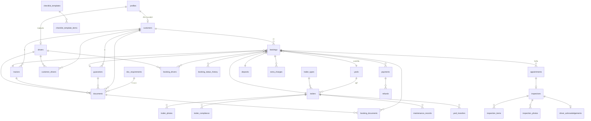

# FAR Service — การออกแบบฐานข้อมูล

| รายการ | รายละเอียด |
|---|---|
| ฐานข้อมูล | Supabase (PostgreSQL 15+) |
| อ้างอิง | [PRD.md](PRD.md) v1.3 (การตัดสินใจ D1–D17), UI ใน `src/` และ `src/lib/mock-data.ts` |
| เวอร์ชัน | v1.0 (Draft) · 7 พฤศจิกายน 2569 |

> สัญลักษณ์ **[สมมติฐาน]** คือจุดที่ PRD ยังไม่ยืนยัน (ดู §13) ออกแบบให้เปลี่ยนค่าได้จากตาราง `settings` โดยไม่ต้องแก้ schema

---

## สารบัญ
1. หลักการออกแบบ
2. แผนภาพความสัมพันธ์ (ERD)
3. Enum
4. ตาราง: ผู้ใช้และบทบาท
5. ตาราง: ลูกค้า ผู้ค้ำ หัวลาก คนขับ
6. ตาราง: ลานจอดและหางเทรลเลอร์
7. ตาราง: เอกสาร
8. ตาราง: การจอง
9. ตาราง: การเงิน
10. ตาราง: นัดรับ–คืนและตรวจสภาพ
11. ตาราง: ระบบ (ตั้งค่า แจ้งเตือน Audit)
12. กฎที่บังคับในฐานข้อมูล (Constraint, Trigger, Function)
13. สิทธิ์การเข้าถึง (Row Level Security)
14. Storage Buckets
15. View และ Query สำคัญ
16. การจับคู่กับหน้าจอ UI
17. ลำดับการสร้าง (Migration Order)
18. คำถามที่ยังเปิดอยู่

---

## 1. หลักการออกแบบ

1. **Supabase Auth เป็นแหล่งตัวตน** — `auth.users` เก็บการล็อกอิน ตาราง `profiles` ผูก 1:1 เก็บบทบาทและข้อมูลแสดงผล
2. **เก็บราคาแบบ snapshot ในการจอง** — เรทของหางเปลี่ยนได้ แต่การจองต้องคงราคาตอนจอง (BR-20: เปลี่ยนเรทมีผลกับการจองใหม่เท่านั้น)
3. **ป้องกันจองซ้อนที่ระดับฐานข้อมูล** — ใช้ `EXCLUDE USING gist` บนช่วงเวลาที่ล็อกหาง (BR-12) ไม่พึ่งการตรวจในแอปอย่างเดียว
4. **เอกสารผูกกับเจ้าของจริง** — ผู้เช่า, ผู้ค้ำ, หัวลาก, คนขับ (D11) แต่ละฉบับใช้ซ้ำข้ามการจองได้ และการจองเก็บ snapshot ว่าใช้ฉบับไหน
5. **ไม่ลบข้อมูลธุรกิจ** — ใช้ `retired_at` / `is_active` / สถานะ แทนการลบ เพื่อ Audit และรายงานย้อนหลัง
6. **ทุกตารางมี** `id uuid default gen_random_uuid()`, `created_at timestamptz default now()`, `updated_at timestamptz` (trigger อัปเดต) เว้นแต่ระบุไว้
7. **เวลาเก็บเป็น `timestamptz`** แสดงผลเป็น Asia/Bangkok, **เงินเก็บเป็น `numeric(12,2)`** หน่วยบาท
8. **RLS เปิดทุกตาราง** สิทธิ์ตาม Access Matrix ใน PRD §5

ส่วนขยายที่ต้องเปิด:
```sql
create extension if not exists btree_gist;   -- exclusion constraint บนช่วงเวลา + uuid
create extension if not exists pgcrypto;     -- gen_random_uuid(), สุ่มรหัสเช็กอิน
create extension if not exists citext;       -- อีเมลไม่สนตัวพิมพ์
```

---

## 2. แผนภาพความสัมพันธ์ (ERD)



---

## 3. Enum

```sql
create type app_role          as enum ('SUPER_ADMIN','SALES','OPS','CUSTOMER','DRIVER');
create type customer_kind     as enum ('COMPANY','PERSON');
create type guarantor_relation as enum ('DIRECTOR','OTHER');

create type trailer_type_code as enum ('FLATBED','SKELETAL','LOWBED');   -- เพิ่มได้ภายหลังด้วย ALTER TYPE
create type trailer_status    as enum ('AVAILABLE','RESERVED','RENTED','INSPECTION','MAINTENANCE','RETIRED');

create type doc_owner         as enum ('CUSTOMER','GUARANTOR','TRACTOR','DRIVER');
create type doc_status        as enum ('PENDING','APPROVED','REJECTED','EXPIRED');

create type booking_status as enum (
  'DRAFT','PENDING_REVIEW','NEED_MORE_DOCS','APPROVED_AWAITING_PAYMENT','CONFIRMED',
  'READY_FOR_PICKUP','IN_RENTAL','RETURNED_PENDING_SETTLEMENT','COMPLETED',
  'REJECTED','CANCELLED','EXPIRED'
);
create type booking_channel   as enum ('WEB','PHONE','LINE','WALK_IN','EMAIL');
create type rate_tier         as enum ('DAILY','WEEKLY','MONTHLY');

create type payment_purpose   as enum ('RENTAL_AND_DEPOSIT','EXTRA_CHARGE');
create type payment_method    as enum ('PROMPTPAY','TRANSFER');          -- D10: ไม่รับบัตร
create type payment_status    as enum ('UNPAID','PENDING_VERIFICATION','PAID','REJECTED','PARTIALLY_REFUNDED','REFUNDED');
create type refund_reason     as enum ('CANCELLATION','EARLY_RETURN','DEPOSIT_RELEASE','COMPANY_CANCEL','OVERPAYMENT');
create type deposit_status    as enum ('PENDING','HELD','RELEASED','PARTIALLY_DEDUCTED','FULLY_DEDUCTED');
create type charge_kind       as enum ('LATE_RETURN','DAMAGE','EARLY_RETURN_DIFF','CANCELLATION_FEE','OTHER');
create type charge_status     as enum ('PROPOSED','APPROVED','WAIVED','SETTLED');

create type appointment_kind  as enum ('PICKUP','RETURN');
create type inspection_kind   as enum ('OUT','IN');
create type checklist_result  as enum ('OK','DAMAGED','NA');
create type ack_result        as enum ('AGREE','REMARK','DISPUTE','REFUSED_TO_SIGN');
create type ack_device        as enum ('DRIVER_PHONE','YARD_TABLET');

create type invite_kind       as enum ('CUSTOMER','DRIVER','STAFF');
```

---

## 4. ตาราง: ผู้ใช้และบทบาท

### 4.1 `profiles` — 1:1 กับ `auth.users`
| คอลัมน์ | ชนิด | หมายเหตุ |
|---|---|---|
| id | uuid PK | = `auth.users.id` (on delete cascade) |
| role | app_role not null | บทบาทเดียวต่อบัญชี |
| full_name | text not null | |
| phone | text | unique where not null — คนขับล็อกอินด้วย OTP เบอร์โทรได้ (FR-AUTH-06) |
| email | citext | unique where not null — คนขับอาจไม่มีอีเมล |
| home_yard_id | uuid FK → yards | เฉพาะ OPS (ลานประจำ) |
| is_active | boolean default true | ระงับบัญชี (FR-AUTH-07) |
| must_change_password | boolean default false | บัญชีพนักงานที่ SA สร้าง (FR-AUTH-04) |
| last_login_at | timestamptz | |

### 4.2 `invites` — คำเชิญตั้งรหัสผ่าน
ใช้กับลูกค้าที่พนักงานสร้างให้ (D3), คนขับที่ลูกค้าเพิ่ม (D14), และพนักงานที่ SA สร้าง

| คอลัมน์ | ชนิด | หมายเหตุ |
|---|---|---|
| id | uuid PK | |
| kind | invite_kind | |
| customer_id | uuid FK → customers | เมื่อ kind = CUSTOMER |
| driver_id | uuid FK → drivers | เมื่อ kind = DRIVER |
| phone / email | text / citext | ช่องทางที่ส่ง |
| token_hash | text not null unique | เก็บ hash ไม่เก็บ token ดิบ |
| sent_count | int default 1 | ปุ่ม "ส่งอีกครั้ง" |
| last_sent_at | timestamptz | |
| expires_at | timestamptz not null | [สมมติฐาน] 7 วัน |
| accepted_at | timestamptz | ตั้งรหัสผ่านแล้ว → สถานะ "ใช้งานแล้ว" |
| invited_by | uuid FK → profiles | |

---

## 5. ตาราง: ลูกค้า ผู้ค้ำ หัวลาก คนขับ

### 5.1 `customers`
| คอลัมน์ | ชนิด | หมายเหตุ |
|---|---|---|
| id | uuid PK | |
| owner_id | uuid FK → profiles unique | null ได้ระหว่างรอลูกค้ารับคำเชิญ (Sales สร้างให้) |
| kind | customer_kind not null | นิติบุคคล / บุคคลธรรมดา |
| name | text not null | ชื่อบริษัท หรือ ชื่อ–นามสกุล |
| tax_id | text not null unique | เลขผู้เสียภาษี / เลขบัตรประชาชน 13 หลัก — `check (tax_id ~ '^\d{13}$')` |
| branch | text default 'สำนักงานใหญ่' | สำหรับใบกำกับภาษี |
| contact_name, phone, email | text / text / citext | |
| billing_address | text not null | ที่อยู่ออกใบกำกับภาษี |
| is_blacklisted | boolean default false | BR-14 (ปลดได้เฉพาะ SA) |
| blacklist_reason | text | |
| pdpa_consent_at | timestamptz | |
| marketing_consent | boolean default false | |
| created_by | uuid FK → profiles | ตัวลูกค้าเอง หรือ Sales/SA |

### 5.2 `guarantors` — ผู้ค้ำประกัน (ทุกสัญญา, D11)
| คอลัมน์ | ชนิด | หมายเหตุ |
|---|---|---|
| id | uuid PK | |
| customer_id | uuid FK → customers not null | |
| relation | guarantor_relation | นิติบุคคล = DIRECTOR · บุคคลธรรมดา = OTHER |
| full_name | text not null | |
| national_id | text | 13 หลัก |
| address | text | |
| phone | text | |
| is_active | boolean default true | |

### 5.3 `tractors` — หัวลากของลูกค้า (D1)
| คอลัมน์ | ชนิด | หมายเหตุ |
|---|---|---|
| id | uuid PK | |
| customer_id | uuid FK → customers not null | |
| plate_no | text not null | รูปแบบ `70-1234` — `check (plate_no ~ '^\d{2}-\d{4}$')` |
| province | text not null | |
| brand | text | |
| kind | text | หัวลาก 6 ล้อ / 10 ล้อ |
| is_active | boolean default true | |
| | | `unique (customer_id, plate_no, province)` |

### 5.4 `drivers` — คนขับหัวลากของลูกค้า (D14)
| คอลัมน์ | ชนิด | หมายเหตุ |
|---|---|---|
| id | uuid PK | |
| profile_id | uuid FK → profiles unique | null จนกว่าจะรับคำเชิญ |
| full_name | text not null | |
| phone | text not null unique | ใช้ส่ง SMS / OTP |
| license_no | text not null | |
| license_class | text not null | ท.2 / ท.3 / ท.4 |
| license_expires_on | date not null | ต้องไม่หมดอายุก่อนวันคืนหาง |
| is_blacklisted | boolean default false | BR-14 |

### 5.5 `customer_drivers` — คนขับ 1 คนขับให้ลูกค้าได้หลายราย [สมมติฐาน]
| คอลัมน์ | ชนิด | หมายเหตุ |
|---|---|---|
| customer_id | uuid FK → customers | PK ร่วม |
| driver_id | uuid FK → drivers | PK ร่วม |
| added_by | uuid FK → profiles | |
| removed_at | timestamptz | ถอดคนขับออก (ไม่ลบประวัติ) |

---

## 6. ตาราง: ลานจอดและหางเทรลเลอร์

### 6.1 `yards`
| คอลัมน์ | ชนิด | หมายเหตุ |
|---|---|---|
| id | uuid PK | |
| number | smallint unique not null | 1 = บางพระ, 2 = หนองใหญ่ (ใช้บนโล่หมายเลข) |
| name | text not null | ลานจอดพนัสมาวิม บางพระ |
| short_name | text not null | บางพระ |
| address | text not null | |
| map_url | text | |
| lat, lng | numeric(9,6) | |
| open_hours | text | [สมมติฐาน] จ.–ส. 08:00–17:00 (PRD Q13) |
| phone | text | ถ้าแต่ละลานมีเบอร์แยก |
| is_active | boolean default true | |

### 6.2 `trailer_types`
| คอลัมน์ | ชนิด | หมายเหตุ |
|---|---|---|
| code | trailer_type_code PK | FLATBED / SKELETAL / LOWBED |
| name_th | text | หางพื้นเรียบ / หางก้างปลา / หางโลว์เบด |
| name_en | text | |
| use_case | text | |
| default_deposit | numeric(12,2) not null | **D15:** 20,000 / 20,000 / 30,000 |
| checklist_template_id | uuid FK → checklist_templates | แม่แบบตามประเภท (FR-ADM-14) |
| sort_order | smallint | |

### 6.3 `trailers`
| คอลัมน์ | ชนิด | หมายเหตุ |
|---|---|---|
| id | uuid PK | |
| code | text unique not null | รหัสช่องจอด เช่น `1-A01` |
| plate_no | text unique not null | |
| vin | text unique | |
| type | trailer_type_code FK not null | |
| brand, model | text | |
| year | smallint | ค.ศ. (แสดง พ.ศ. ที่ UI) |
| length_ft | smallint | |
| axles | smallint | |
| payload_ton, tare_ton | numeric(5,1) | |
| current_yard_id | uuid FK → yards not null | อัปเดตอัตโนมัติเมื่อคืนต่างลาน (D13) |
| status | trailer_status default 'AVAILABLE' | สถานะ "ตอนนี้" — ความว่างในอนาคตคำนวณจาก bookings |
| daily_rate, weekly_rate, monthly_rate | numeric(12,2) not null | `check (> 0)` แก้ได้เฉพาะ SALES/SA |
| deposit_amount | numeric(12,2) | null = ใช้ `trailer_types.default_deposit` · แก้ได้เฉพาะ SA |
| is_published | boolean default true | แสดงบนหน้าเว็บ |
| description | text | |
| retired_at | timestamptz | ปลดระวาง (soft delete) |

### 6.4 `trailer_photos`
| คอลัมน์ | ชนิด | หมายเหตุ |
|---|---|---|
| trailer_id | uuid FK | |
| storage_path | text | bucket `trailer-photos` |
| caption | text | ด้านข้าง / ด้านท้าย / คิงพิน ... |
| sort_order | smallint | |

### 6.5 `trailer_compliance` — ภาษี/พ.ร.บ./ประกันของหาง (FR-FLEET-05, BR-13)
| คอลัมน์ | ชนิด | หมายเหตุ |
|---|---|---|
| trailer_id | uuid FK | |
| kind | text check in ('TAX','CMI','INSURANCE','INSPECTION') | |
| expires_on | date not null | |
| document_path | text | |

### 6.6 `maintenance_records`
| คอลัมน์ | ชนิด | หมายเหตุ |
|---|---|---|
| trailer_id | uuid FK | |
| reason | text not null | |
| starts_at | timestamptz not null | |
| expected_end_at | timestamptz | |
| ended_at | timestamptz | |
| period | tstzrange generated | `tstzrange(starts_at, coalesce(ended_at, expected_end_at, 'infinity'))` — ใช้ตรวจชนการจอง |
| created_by | uuid FK → profiles | |

### 6.7 `yard_transfers` — ย้ายหางระหว่างลาน (FR-OPS-05)
| คอลัมน์ | ชนิด | หมายเหตุ |
|---|---|---|
| trailer_id | uuid FK | |
| from_yard_id, to_yard_id | uuid FK → yards | `check (from <> to)` |
| reason | text check in ('RETURN_OTHER_YARD','REBALANCE') | คืนต่างลานสร้างแถวนี้อัตโนมัติ |
| booking_id | uuid FK → bookings | เมื่อเกิดจากการคืนต่างลาน |
| moved_at | timestamptz | |
| moved_by | uuid FK → profiles | |

---

## 7. ตาราง: เอกสาร

### 7.1 `doc_requirements` — รายการเอกสารที่ต้องใช้ (ตั้งค่าได้, FR-DOC-01)
| คอลัมน์ | ชนิด | หมายเหตุ |
|---|---|---|
| key | text PK | `company_cert`, `pp20`, `director_id`, ... |
| label | text not null | |
| owner | doc_owner not null | เอกสารนี้ผูกกับใคร |
| applies_to | customer_kind[] | null = ทุกสัญญา |
| rule | text | "ประทับตราบริษัท" / "เซ็นรับรองสำเนาถูกต้อง ไม่ประทับตราบริษัท" |
| review_checks | text[] | รายการติ๊กของผู้ตรวจ (FR-DOC-05) |
| max_age_days | int | หนังสือรับรองบริษัท [สมมติฐาน] 90 วัน (PRD Q7) |
| has_expiry | boolean | กรมธรรม์, ใบขับขี่ |
| is_required | boolean default true | |
| sort_order | smallint | |

ค่าเริ่มต้น (D11):

| key | label | owner | applies_to |
|---|---|---|---|
| company_cert | หนังสือรับรองบริษัท | CUSTOMER | {COMPANY} |
| pp20 | ภ.พ.20 | CUSTOMER | {COMPANY} |
| director_id | สำเนาบัตรประชาชนกรรมการ | GUARANTOR | {COMPANY} |
| director_house | สำเนาทะเบียนบ้านกรรมการ | GUARANTOR | {COMPANY} |
| renter_id | สำเนาบัตรประชาชนผู้เช่า | CUSTOMER | {PERSON} |
| renter_house | สำเนาทะเบียนบ้านผู้เช่า | CUSTOMER | {PERSON} |
| guarantor_id | สำเนาบัตรประชาชนผู้ค้ำ | GUARANTOR | {PERSON} |
| guarantor_house | สำเนาทะเบียนบ้านผู้ค้ำ | GUARANTOR | {PERSON} |
| tractor_book | สำเนาหน้าเล่มทะเบียนหัวลาก | TRACTOR | null |
| tractor_policy | สำเนากรมธรรม์หัวลาก | TRACTOR | null |
| driver_license | สำเนาใบขับขี่คนขับหัวลาก | DRIVER | null |

### 7.2 `documents` — ไฟล์เอกสารแต่ละฉบับ
ใช้ FK แยกต่อเจ้าของ (แทน polymorphic id) เพื่อให้ฐานข้อมูลตรวจความถูกต้องได้

| คอลัมน์ | ชนิด | หมายเหตุ |
|---|---|---|
| id | uuid PK | |
| requirement_key | text FK → doc_requirements | |
| customer_id | uuid FK → customers | |
| guarantor_id | uuid FK → guarantors | |
| tractor_id | uuid FK → tractors | |
| driver_id | uuid FK → drivers | |
| | | `check (num_nonnulls(customer_id, guarantor_id, tractor_id, driver_id) = 1)` |
| storage_path | text not null | bucket `documents` (private) |
| file_name | text | |
| mime_type | text | `check in ('image/jpeg','image/png','application/pdf')` |
| size_bytes | int | `check (size_bytes <= 10485760)` (10 MB) |
| status | doc_status default 'PENDING' | |
| review_checks | jsonb | ผลติ๊กของผู้ตรวจ `{ "มีตราประทับบริษัท": true, ... }` |
| reject_reason | text | ลูกค้าเห็นข้อความนี้ |
| reviewed_by | uuid FK → profiles | |
| reviewed_at | timestamptz | |
| expires_on | date | |
| uploaded_by | uuid FK → profiles | ลูกค้า หรือ Sales/SA (FR-BOOK-16) |
| superseded_by | uuid FK → documents | เมื่ออัปโหลดไฟล์ใหม่แทน (เก็บฉบับเก่าไว้) |

ดัชนี: ฉบับ "ปัจจุบัน" ต่อเจ้าของและประเภท

```sql
create unique index documents_current_uq on documents
  (requirement_key, coalesce(customer_id, guarantor_id, tractor_id, driver_id))
  where superseded_by is null;
```

---

## 8. ตาราง: การจอง

### 8.1 `bookings`
| คอลัมน์ | ชนิด | หมายเหตุ |
|---|---|---|
| id | uuid PK | |
| booking_no | text unique not null | `FAR-YYMM-NNNNN` สร้างโดย trigger (§12.1) |
| customer_id | uuid FK → customers not null | |
| trailer_id | uuid FK → trailers not null | |
| guarantor_id | uuid FK → guarantors not null | ทุกสัญญามีผู้ค้ำ (D11) |
| tractor_id | uuid FK → tractors not null | BR-19 |
| pickup_yard_id | uuid FK → yards not null | = ลานที่หางอยู่ ณ วันรับ (BR-22) |
| return_yard_id | uuid FK → yards not null | คืนต่างลานได้ฟรี (D13) |
| pickup_at | timestamptz not null | |
| return_at | timestamptz not null | `check (return_at > pickup_at)` |
| lock_range | tstzrange not null | `[pickup_at, return_at + buffer)` ตั้งโดย trigger (BR-04) |
| status | booking_status default 'PENDING_REVIEW' | |
| channel | booking_channel default 'WEB' | |
| created_by | uuid FK → profiles not null | ลูกค้าเอง / Sales / SA |
| approved_by | uuid FK → profiles | |
| approved_at | timestamptz | |
| self_approved | boolean default false | SA อนุมัติการจองที่ตัวเองสร้าง (D9) |
| reject_reason, cancel_reason | text | |
| cancelled_by | uuid FK → profiles | |
| need_docs_due_at | timestamptz | ส่งเอกสารเพิ่มภายใน 48 ชม. (BR-10) |
| payment_due_at | timestamptz | ชำระภายใน 24 ชม. หลังอนุมัติ (BR-09) |
| **ราคา snapshot** | | |
| rate_daily, rate_weekly, rate_monthly | numeric(12,2) | เรทของหาง ณ เวลาจอง |
| rental_days | int not null | ตาม BR-01 |
| rate_tier | rate_tier not null | BR-02 |
| rental_amount | numeric(12,2) | ก่อน VAT |
| vat_rate | numeric(4,3) default 0.07 | |
| vat_amount | numeric(12,2) | |
| deposit_amount | numeric(12,2) | D15 |
| total_amount | numeric(12,2) | ค่าเช่า + VAT + เงินค้ำ |
| **ข้อมูลจริง** | | |
| actual_pickup_at | timestamptz | |
| actual_return_at | timestamptz | |
| actual_return_yard_id | uuid FK → yards | |
| early_termination | boolean default false | D16 |
| recalculated_days | int | |
| recalculated_tier | rate_tier | |
| recalculated_rental | numeric(12,2) | |
| cancellation_fee | numeric(12,2) | D17 |
| **ใบกำกับภาษี** | | |
| invoice_name, invoice_tax_id, invoice_branch, invoice_address | text | snapshot จากลูกค้า แก้ได้ต่อการจอง |
| flagged_reason | text | เช่น คนขับโต้แย้งผลตรวจ |
| internal_note | text | ลูกค้ามองไม่เห็น (FR-APV-07) |

**ไม่มีคอลัมน์ส่วนลด** (D5, BR-20)

### 8.2 `booking_drivers`
| คอลัมน์ | ชนิด | หมายเหตุ |
|---|---|---|
| booking_id | uuid FK | PK ร่วม |
| driver_id | uuid FK | PK ร่วม |
| is_primary | boolean | คนขับหลักที่ใช้ตรวจเอกสาร |

### 8.3 `booking_documents` — เอกสารที่ใช้ในการจองนี้
เก็บว่าอนุมัติการจองด้วยไฟล์ฉบับไหน แม้ลูกค้าจะอัปโหลดฉบับใหม่ภายหลัง

| คอลัมน์ | ชนิด | หมายเหตุ |
|---|---|---|
| booking_id | uuid FK | PK ร่วม |
| document_id | uuid FK | PK ร่วม |
| requirement_key | text | |

### 8.4 `booking_status_history`
| คอลัมน์ | ชนิด | หมายเหตุ |
|---|---|---|
| id | bigint identity PK | |
| booking_id | uuid FK | |
| from_status, to_status | booking_status | |
| changed_by | uuid FK → profiles | null = ระบบ (เช่น หมดเวลา) |
| note | text | |
| created_at | timestamptz | |

ใช้แสดง Timeline ในหน้ารายละเอียดการจอง และวัด Approval Lead Time (KPI)

---

## 9. ตาราง: การเงิน

### 9.1 `payments`
| คอลัมน์ | ชนิด | หมายเหตุ |
|---|---|---|
| id | uuid PK | |
| booking_id | uuid FK not null | |
| purpose | payment_purpose | ชำระครั้งแรก / ชำระค่าใช้จ่ายเพิ่ม |
| extra_charge_id | uuid FK → extra_charges | เมื่อ purpose = EXTRA_CHARGE |
| method | payment_method not null | PROMPTPAY / TRANSFER |
| amount | numeric(12,2) not null | `check (amount > 0)` |
| status | payment_status default 'UNPAID' | |
| promptpay_ref | text | อ้างอิงจาก QR |
| slip_path | text | bucket `payment-slips` |
| recorded_by | uuid FK → profiles | ลูกค้า หรือ Sales/SA บันทึกแทน |
| verified_by | uuid FK → profiles | BR-17 |
| verified_at | timestamptz | |
| paid_at | timestamptz | |
| receipt_no | text unique | เลขใบเสร็จ |
| tax_invoice_no | text unique | |

### 9.2 `refunds`
| คอลัมน์ | ชนิด | หมายเหตุ |
|---|---|---|
| id | uuid PK | |
| booking_id | uuid FK | |
| payment_id | uuid FK | |
| reason | refund_reason | |
| amount | numeric(12,2) | |
| proof_path | text | หลักฐานการโอนคืน |
| refunded_by | uuid FK → profiles | |
| refunded_at | timestamptz | |

### 9.3 `deposits` — เงินค้ำประกัน 1 รายการต่อการจอง
| คอลัมน์ | ชนิด | หมายเหตุ |
|---|---|---|
| booking_id | uuid PK FK | |
| amount | numeric(12,2) | |
| status | deposit_status default 'PENDING' | HELD เมื่อชำระแล้ว |
| deducted_amount | numeric(12,2) default 0 | |
| released_amount | numeric(12,2) | |
| released_at | timestamptz | ภายใน 7 วันทำการ [สมมติฐาน] (PRD Q8) |

### 9.4 `extra_charges` — ค่าใช้จ่ายหลังคืนหาง / ค่าธรรมเนียม
| คอลัมน์ | ชนิด | หมายเหตุ |
|---|---|---|
| id | uuid PK | |
| booking_id | uuid FK | |
| kind | charge_kind | คืนช้า / ความเสียหาย / ส่วนต่างคืนก่อนกำหนด / ค่าธรรมเนียมยกเลิก |
| amount | numeric(12,2) | ค่าลบ = คืนให้ลูกค้า (เช่น ส่วนต่างคืนก่อนกำหนด) |
| description | text | |
| inspection_item_id | uuid FK → inspection_items | ค่าเสียหายผูกกับจุดที่ตรวจพบ |
| status | charge_status default 'PROPOSED' | Ops เสนอ → Sales/SA อนุมัติ (FR-OPS-08) |
| proposed_by, approved_by | uuid FK → profiles | |
| settle_from_deposit | boolean default true | หักจากเงินค้ำก่อน (FR-PAY-07) |

---

## 10. ตาราง: นัดรับ–คืนและตรวจสภาพ

### 10.1 `appointments` — 2 นัดต่อการจอง (รับ, คืน)
| คอลัมน์ | ชนิด | หมายเหตุ |
|---|---|---|
| id | uuid PK | |
| booking_id | uuid FK not null | |
| kind | appointment_kind | `unique (booking_id, kind)` |
| yard_id | uuid FK → yards | |
| scheduled_at | timestamptz | |
| checkin_code | char(6) | รหัส 6 หลัก |
| checkin_token_hash | text | ข้อมูลใน QR (เก็บ hash) |
| code_valid_from, code_valid_to | timestamptz | วันนัด ±1 วัน [สมมติฐาน] |
| checked_in_at | timestamptz | |
| checked_in_by | uuid FK → profiles | Ops |
| driver_id | uuid FK → drivers | คนขับที่มาจริง |
| tractor_plate_seen | text | ทะเบียนที่ Ops เห็นจริง |
| identity_match | boolean | BR-23 — false = ห้ามส่งมอบ |
| completed_at | timestamptz | |

### 10.2 `checklist_templates` และ `checklist_template_items`
| ตาราง | คอลัมน์ |
|---|---|
| checklist_templates | id, name, trailer_type (nullable = ใช้ได้ทุกประเภท), is_active |
| checklist_template_items | id, template_id FK, group_label (โครงสร้าง/ล้อและยาง/...), item_key, label, sort_order |

### 10.3 `inspections` — Checklist เต็มฉบับโดย Ops (D7, D8)
| คอลัมน์ | ชนิด | หมายเหตุ |
|---|---|---|
| id | uuid PK | |
| appointment_id | uuid FK unique | 1 ฉบับต่อนัด |
| kind | inspection_kind | OUT (ก่อนส่งมอบ) / IN (หลังรับคืน) |
| template_id | uuid FK | |
| inspector_id | uuid FK → profiles | OPS หรือ SA |
| notes | text | |
| damaged_count | int | สรุปเพื่อแสดงผลเร็ว |
| completed_at | timestamptz | |

### 10.4 `inspection_items`
| คอลัมน์ | ชนิด | หมายเหตุ |
|---|---|---|
| id | uuid PK | |
| inspection_id | uuid FK | |
| item_key | text | |
| label | text | snapshot จากแม่แบบ |
| result | checklist_result not null | |
| note | text | |
| | | `unique (inspection_id, item_key)` |

### 10.5 `inspection_photos`
| คอลัมน์ | ชนิด | หมายเหตุ |
|---|---|---|
| id | uuid PK | |
| inspection_id | uuid FK | |
| inspection_item_id | uuid FK | null = รูป 4 มุม |
| angle | text check in ('FRONT','REAR','LEFT','RIGHT','DETAIL') | ต้องมีครบ 4 มุมก่อนปิด Checklist |
| storage_path | text | bucket `inspection-photos` |
| taken_by | uuid FK → profiles | Ops หรือคนขับ (รูปประกอบข้อโต้แย้ง) |
| taken_at | timestamptz | |

### 10.6 `driver_acknowledgements` — คนขับยืนยันแบบย่อ (FR-DRV-04)
| คอลัมน์ | ชนิด | หมายเหตุ |
|---|---|---|
| inspection_id | uuid PK FK | 1 ต่อ inspection |
| driver_id | uuid FK → drivers | |
| result | ack_result not null | ตรง/รับทราบ, ข้อสังเกต, โต้แย้ง, ปฏิเสธการเซ็น |
| remark | text | บังคับเมื่อ REMARK/DISPUTE |
| signature_path | text | bucket `signatures` · null ได้เฉพาะ REFUSED_TO_SIGN |
| device | ack_device | มือถือคนขับ / แท็บเล็ตลาน |
| geo_lat, geo_lng | numeric(9,6) | FR-DRV-07 |
| signed_at | timestamptz | |

---

## 11. ตาราง: ระบบ

### 11.1 `settings` — ค่านโยบายที่ SA แก้ได้ (FR-ADM-12)
| key | ค่าเริ่มต้น | อ้างอิง |
|---|---|---|
| `vat_rate` | 0.07 | BR-06 |
| `weekly_tier_min_days` | 7 | BR-02 |
| `monthly_tier_min_days` | 30 | BR-02 |
| `day_remainder_hours` | 3 | BR-01 [สมมติฐาน] |
| `booking_buffer` | `'1 day'` | BR-04 [สมมติฐาน] |
| `min_lead_hours` / `max_advance_days` | 24 / 180 | BR-03 [สมมติฐาน] |
| `payment_window_hours` | 24 | BR-09 |
| `need_docs_window_hours` | 48 | BR-10 |
| `cancellation_fee` | `null` (รอยืนยัน) | D17 / PRD Q1 |
| `late_return_multiplier` | 1.5 | BR-11 [สมมติฐาน] |
| `deposit_refund_business_days` | 7 | BR-05 [สมมติฐาน] |
| `company_profile` | `{ name, tax_id, address, phone: "090-289-4964", logo_path }` | FR-ADM-16 |
| `payment_accounts` | `{ promptpay_id, bank, account_no, account_name }` | FR-ADM-15 |

โครงสร้าง: `key text PK, value jsonb not null, updated_by uuid, updated_at timestamptz`

### 11.2 `notifications`
| คอลัมน์ | ชนิด | หมายเหตุ |
|---|---|---|
| id | uuid PK | |
| recipient_id | uuid FK → profiles | null ได้ ถ้าส่งไปเบอร์/อีเมลที่ยังไม่มีบัญชี |
| channel | text check in ('IN_APP','EMAIL','SMS','LINE') | |
| event | text | `booking.approved`, `appointment.reminder`, ... (PRD §12) |
| booking_id | uuid FK | |
| payload | jsonb | |
| sent_at, read_at | timestamptz | |
| error | text | |

### 11.3 `audit_logs` (FR-ADM-19)
| คอลัมน์ | ชนิด | หมายเหตุ |
|---|---|---|
| id | bigint identity PK | |
| actor_id | uuid | null = ระบบ |
| action | text | `insert` / `update` / `delete` / `approve_self` |
| table_name | text | |
| row_id | uuid | |
| before, after | jsonb | |
| ip | inet | |
| created_at | timestamptz | เก็บอย่างน้อย 2 ปี |

ติด trigger บน: bookings, payments, refunds, deposits, extra_charges, trailers, documents, profiles, customers, settings

### 11.4 `contact_messages` — ฟอร์มติดต่อเรา
`id, name, phone, message, handled_by, handled_at, created_at`

---

## 12. กฎที่บังคับในฐานข้อมูล

### 12.1 เลขการจอง
```sql
create table booking_counters (yymm char(4) primary key, last_no int not null);

create function next_booking_no() returns text language plpgsql as $$
declare k char(4) := to_char(now() at time zone 'Asia/Bangkok', 'YYMM'); n int;
begin
  insert into booking_counters values (k, 1)
  on conflict (yymm) do update set last_no = booking_counters.last_no + 1
  returning last_no into n;
  return format('FAR-%s-%s', k, lpad(n::text, 5, '0'));
end $$;
```

### 12.2 ป้องกันจองซ้อน (BR-12) — หัวใจของระบบ
```sql
-- lock_range รวม buffer หลังคืน (BR-04) ตั้งค่าด้วย trigger ก่อน insert/update
create function set_lock_range() returns trigger language plpgsql as $$
begin
  new.lock_range := tstzrange(new.pickup_at,
                              new.return_at + (select (value #>> '{}')::interval from settings where key = 'booking_buffer'),
                              '[)');
  return new;
end $$;

create trigger bookings_lock_range before insert or update of pickup_at, return_at
  on bookings for each row execute function set_lock_range();

-- หางคันเดียวกัน ห้ามมีช่วงเวลาซ้อนกัน เฉพาะสถานะที่ล็อกหาง
alter table bookings add constraint bookings_no_overlap
  exclude using gist (trailer_id with =, lock_range with &&)
  where (status in ('PENDING_REVIEW','NEED_MORE_DOCS','APPROVED_AWAITING_PAYMENT',
                    'CONFIRMED','READY_FOR_PICKUP','IN_RENTAL','RETURNED_PENDING_SETTLEMENT'));
```
- คืนก่อนกำหนด (D16): trigger ตั้ง `return_at = actual_return_at` → ช่วงที่ล็อกหดลง ปลดวันที่เหลือทันที
- ช่วงซ่อม: ตรวจใน `create_booking()` ว่า `lock_range` ไม่ชน `maintenance_records.period`

### 12.3 ฟังก์ชันสร้างการจอง `create_booking(...)` (security definer)
ทำใน transaction เดียว ใช้ทั้งลูกค้าจองเองและพนักงานจองแทน
1. ตรวจสิทธิ์: ผู้เรียกเป็นเจ้าของ `customer_id` หรือเป็น SALES/SA (D3, D5)
2. ตรวจลูกค้า/คนขับไม่ติด Blacklist (BR-14)
3. ตรวจหัวลากและคนขับเป็นของลูกค้านี้ (BR-19) และใบขับขี่ไม่หมดอายุก่อนวันคืน
4. ตรวจหางอยู่ที่ `pickup_yard_id` ณ วันรับ (BR-22, ดู §15.2)
5. ตรวจเอกสารหางไม่หมดอายุก่อนวันคืน (BR-13) และไม่ชนช่วงซ่อม
6. **คำนวณราคาฝั่ง server** จาก `trailers` + `settings` (ไม่รับยอดเงินจากผู้เรียก — กันแก้ราคา/ส่วนลด, BR-20)
7. insert `bookings` (exclusion constraint กันจองซ้อนตอนนี้), `booking_drivers`, `booking_documents`, `deposits`, `appointments` 2 แถว, `booking_status_history`

### 12.4 การเปลี่ยนสถานะ — ทำผ่านฟังก์ชันเท่านั้น
ตารางทางผ่านที่อนุญาต (trigger `bookings_status_guard` ปฏิเสธทางอื่น):

| จาก | ไป | ผู้ทำ / เงื่อนไข |
|---|---|---|
| PENDING_REVIEW | NEED_MORE_DOCS / APPROVED_AWAITING_PAYMENT / REJECTED | Sales, SA · ดูกฎผู้อนุมัติด้านล่าง |
| NEED_MORE_DOCS | PENDING_REVIEW | ลูกค้าส่งเอกสารใหม่ |
| NEED_MORE_DOCS | EXPIRED | ระบบ เมื่อเกิน `need_docs_due_at` |
| APPROVED_AWAITING_PAYMENT | CONFIRMED | เมื่อ payment = PAID |
| APPROVED_AWAITING_PAYMENT | EXPIRED | ระบบ เมื่อเกิน `payment_due_at` |
| CONFIRMED | READY_FOR_PICKUP | Ops ปิด Checklist OUT |
| READY_FOR_PICKUP | IN_RENTAL | เช็กอินผ่าน + คนขับเซ็น (BR-16, BR-23) |
| IN_RENTAL | RETURNED_PENDING_SETTLEMENT | Ops ปิด Checklist IN + คนขับเซ็น/ปฏิเสธเซ็น |
| RETURNED_PENDING_SETTLEMENT | COMPLETED | Sales/SA ปิดยอด เงินค้ำ RELEASED/DEDUCTED |
| สถานะก่อน IN_RENTAL | CANCELLED | ลูกค้า (ของตัวเอง) / Sales / SA |

**กฎผู้อนุมัติ (BR-15, D6, D9):**
```sql
-- ใน approve_booking(booking_id)
if v_role = 'SALES' and v_booking.created_by = auth.uid() then
  raise exception 'การจองที่ Sales สร้างเอง ต้องให้ Super Admin อนุมัติ';
end if;
if v_role = 'SALES' and (select role from profiles where id = v_booking.created_by) = 'SALES' then
  raise exception 'การจองที่ Sales สร้างแทนลูกค้า ต้องให้ Super Admin อนุมัติ';
end if;
-- SA อนุมัติได้ทุกการจอง รวมของตัวเอง → self_approved = (created_by = auth.uid())
```
- อนุมัติได้เมื่อเอกสารใน `booking_documents` เป็น APPROVED ครบทุกฉบับที่ `is_required`
- อนุมัติแล้วตั้ง `payment_due_at = now() + payment_window_hours`
- กฎเดียวกันใช้กับ `verify_payment()` (BR-17): payment ที่ SALES บันทึก ต้องให้ SA ยืนยัน

### 12.5 ชำระเงิน (D2, BR-18)
```sql
-- สร้าง payment ได้เฉพาะเมื่อการจองอนุมัติแล้ว
create function check_payment_allowed() returns trigger language plpgsql as $$
begin
  if new.purpose = 'RENTAL_AND_DEPOSIT' and
     (select status from bookings where id = new.booking_id) <> 'APPROVED_AWAITING_PAYMENT' then
    raise exception 'ชำระได้หลังการจองได้รับอนุมัติเท่านั้น';
  end if;
  return new;
end $$;
```
เมื่อ payment → PAID: bookings → CONFIRMED, deposits → HELD, หางที่ใกล้วันรับ → `RESERVED`

### 12.6 คืนหาง
trigger หลัง Checklist IN ปิด:
1. ตั้ง `actual_return_at`, `actual_return_yard_id`
2. ถ้า `actual_return_yard_id <> trailers.current_yard_id` → insert `yard_transfers (reason = 'RETURN_OTHER_YARD')` และอัปเดต `trailers.current_yard_id` (D13)
3. ถ้าคืนก่อน `return_at` → `early_termination = true`, คำนวณ `recalculated_*` (D16), สร้าง `extra_charges (EARLY_RETURN_DIFF, amount ติดลบ = คืนลูกค้า)`
4. ถ้าคืนช้า → สร้าง `extra_charges (LATE_RETURN, PROPOSED)`
5. `trailers.status = 'INSPECTION'` จนกว่าจะพ้น buffer

### 12.7 ยกเลิกก่อนรับหาง (D17)
- ยังไม่ชำระ → CANCELLED ไม่มีค่าใช้จ่าย [สมมติฐาน]
- ชำระแล้ว → `extra_charges (CANCELLATION_FEE)` ตามค่า `settings.cancellation_fee` แล้วสร้าง `refunds` ส่วนที่เหลือ + `refunds (DEPOSIT_RELEASE)` เต็มจำนวน
- บริษัทยกเลิก → คืน 100% (BR-08)

### 12.8 งานตามเวลา (pg_cron)
| งาน | ความถี่ |
|---|---|
| หมดเวลาชำระ / ส่งเอกสาร → EXPIRED | ทุก 15 นาที |
| เอกสารลูกค้า/คนขับ/หัวลาก/หาง ที่ `expires_on` ถึงแล้ว → EXPIRED + แจ้งเตือน 30 วันล่วงหน้า | วันละครั้ง |
| แจ้งเตือนนัดรับ/คืนพรุ่งนี้ + ส่ง QR ให้คนขับ | วันละครั้ง 17:00 |
| คืนหางเกินกำหนด → แจ้ง Ops/Sales/ลูกค้า | ทุกชั่วโมง |
| สรุปยอดรายวันให้ SA | วันละครั้ง |

---

## 13. สิทธิ์การเข้าถึง (Row Level Security)

### 13.1 ฟังก์ชันช่วย
```sql
create function auth_role() returns app_role language sql stable security definer as
  $$ select role from profiles where id = auth.uid() and is_active $$;

create function is_staff() returns boolean language sql stable as
  $$ select auth_role() in ('SUPER_ADMIN','SALES','OPS') $$;

create function my_customer_id() returns uuid language sql stable security definer as
  $$ select id from customers where owner_id = auth.uid() $$;

create function my_driver_id() returns uuid language sql stable security definer as
  $$ select id from drivers where profile_id = auth.uid() $$;
```

### 13.2 สรุปสิทธิ์ต่อตาราง (R = อ่าน, W = เขียน)
| ตาราง | SA | Sales | Ops | Customer | Driver |
|---|---|---|---|---|---|
| yards, trailer_types, trailers (published), trailer_photos | RW | RW | RW | R | R |
| ราคาใน trailers | W | W | — | — | — |
| maintenance_records, yard_transfers | RW | R | RW | — | — |
| customers | RW | RW | R (ชื่อ) | RW ของตน | — |
| guarantors, tractors, customer_drivers | RW | RW | R | RW ของตน | — |
| drivers | RW | RW | R | RW ที่ผูกกับตน | R/W ของตน |
| documents | RW | RW | R เฉพาะ `driver_license`, `tractor_book` ตอนเช็กอิน | RW ของตน (ไม่แก้ status) | R ใบขับขี่ตน |
| bookings | RW | RW | R | R ของตน (เขียนผ่านฟังก์ชัน) | R ที่ตนเป็นคนขับ (ไม่เห็นยอดเงิน — ใช้ view) |
| payments, refunds, deposits, extra_charges | RW | RW | R extra_charges (เสนอได้) | R ของตน, W สลิป | — |
| appointments | RW | R | RW | R ของตน | R ของตน |
| inspections, inspection_items, inspection_photos | RW | R | RW | R ของตน | R ของตน |
| driver_acknowledgements | RW | R | RW (เซ็นบนแท็บเล็ต) | R | W ของตน (ครั้งเดียว) |
| settings, checklist_templates, doc_requirements | RW | R | R | R (doc_requirements) | — |
| audit_logs | R | — | — | — | — |
| profiles | RW | R | R | R/W ของตน | R/W ของตน |

### 13.3 ตัวอย่าง policy
```sql
alter table bookings enable row level security;

create policy bookings_staff_read on bookings for select using (is_staff());

create policy bookings_customer_read on bookings for select
  using (customer_id = my_customer_id());

create policy bookings_driver_read on bookings for select
  using (exists (select 1 from booking_drivers bd
                 where bd.booking_id = bookings.id and bd.driver_id = my_driver_id()));

-- ไม่มี insert/update policy ให้ client: เขียนผ่าน create_booking(), approve_booking(), ... เท่านั้น

alter table documents enable row level security;
create policy documents_owner on documents for all
  using (customer_id = my_customer_id()
      or guarantor_id in (select id from guarantors where customer_id = my_customer_id())
      or tractor_id   in (select id from tractors   where customer_id = my_customer_id())
      or driver_id    in (select driver_id from customer_drivers where customer_id = my_customer_id()))
  with check (status = 'PENDING');          -- ลูกค้าอัปโหลดได้ แต่ตั้งสถานะผ่านเองไม่ได้
create policy documents_review on documents for all
  using (auth_role() in ('SUPER_ADMIN','SALES'));
```

> คนขับต้องไม่เห็นยอดเงินและเอกสารบริษัท (PRD §5.1 หมายเหตุ ²) → ให้คนขับอ่านผ่าน view `driver_appointments_v` (§15.3) ไม่ใช่ตาราง bookings ตรง

---

## 14. Storage Buckets

| Bucket | Public | ใครอัปโหลด | ใครอ่าน | path |
|---|---|---|---|---|
| `trailer-photos` | ใช่ | Staff | ทุกคน | `{trailer_id}/{file}` |
| `documents` | ไม่ | ลูกค้า, Sales/SA | เจ้าของ, Sales/SA (Ops เฉพาะใบขับขี่/เล่มหัวลาก) | `{customer_id}/{requirement_key}/{uuid}.{ext}` |
| `payment-slips` | ไม่ | ลูกค้า, Sales/SA | เจ้าของ, Sales/SA | `{booking_id}/{uuid}.{ext}` |
| `inspection-photos` | ไม่ | Ops, คนขับ (ข้อโต้แย้ง) | Staff, ลูกค้าและคนขับของการจองนั้น | `{booking_id}/{inspection_id}/{uuid}.jpg` |
| `signatures` | ไม่ | คนขับ, Ops | Staff, ลูกค้าของการจองนั้น | `{booking_id}/{inspection_id}.png` |
| `refund-proofs` | ไม่ | Sales/SA | Sales/SA, เจ้าของ | `{booking_id}/{uuid}` |

- เข้าถึงไฟล์ private ผ่าน Signed URL อายุสั้น (เช่น 5 นาที)
- จำกัดชนิดไฟล์และขนาด 10 MB ที่ policy ของ bucket

---

## 15. View และ Query สำคัญ

### 15.1 หางว่างในช่วงวัน (หน้าค้นหา)
```sql
select t.*
from trailers t
where t.is_published and t.retired_at is null and t.status <> 'MAINTENANCE'
  and (:type is null or t.type = :type)
  and not exists (
    select 1 from bookings b
    where b.trailer_id = t.id
      and b.status in ('PENDING_REVIEW','NEED_MORE_DOCS','APPROVED_AWAITING_PAYMENT','CONFIRMED',
                       'READY_FOR_PICKUP','IN_RENTAL','RETURNED_PENDING_SETTLEMENT')
      and b.lock_range && tstzrange(:from, :to + interval '1 day'))
  and not exists (
    select 1 from maintenance_records m
    where m.trailer_id = t.id and m.period && tstzrange(:from, :to));
```

### 15.2 ลานที่หางจะอยู่ ณ วันรับ (BR-22)
```sql
create function expected_yard(p_trailer uuid, p_at timestamptz) returns uuid language sql stable as $$
  select coalesce(
    (select b.return_yard_id from bookings b
      where b.trailer_id = p_trailer and b.return_at <= p_at
        and b.status not in ('REJECTED','CANCELLED','EXPIRED','DRAFT')
      order by b.return_at desc limit 1),
    (select current_yard_id from trailers where id = p_trailer));
$$;
```
หน้าค้นหาใช้ `expected_yard(t.id, :from) = :yard` แทน `current_yard_id`

### 15.3 `driver_appointments_v` — สิ่งที่คนขับเห็น
```sql
create view driver_appointments_v with (security_invoker = true) as
select a.id, a.kind, a.scheduled_at, a.checkin_code, a.completed_at,
       y.number as yard_number, y.short_name, y.address, y.map_url,
       t.code as trailer_code, t.plate_no as trailer_plate, t.type,
       tr.plate_no as tractor_plate, b.booking_no, c.name as customer_name
from appointments a
join bookings b on b.id = a.booking_id
join booking_drivers bd on bd.booking_id = b.id and bd.driver_id = my_driver_id()
join yards y on y.id = a.yard_id
join trailers t on t.id = b.trailer_id
join tractors tr on tr.id = b.tractor_id
join customers c on c.id = b.customer_id;
-- ไม่มีคอลัมน์เงิน ไม่มีเอกสาร
```

### 15.4 คิวอนุมัติ (หลังบ้าน)
| แท็บ | เงื่อนไข |
|---|---|
| รอตรวจเอกสาร | `status in ('PENDING_REVIEW','NEED_MORE_DOCS')` และผู้สร้างไม่ใช่ SALES |
| รอ Super Admin อนุมัติ | `status = 'PENDING_REVIEW'` และ role ของ `created_by` = SALES |
| รอชำระ / ตรวจสลิป | `status = 'APPROVED_AWAITING_PAYMENT'` หรือมี payment `PENDING_VERIFICATION` |
| รอสรุปยอดหลังคืน | `status = 'RETURNED_PENDING_SETTLEMENT'` |
| ป้ายด่วน | `pickup_at - now() <= interval '48 hours'` |

### 15.5 Dashboard
- รายได้รายเดือน: `sum(coalesce(recalculated_rental, rental_amount))` จาก bookings ที่ CONFIRMED ขึ้นไป แบ่งตามเดือนของ `pickup_at`
- Utilization ต่อคัน: จำนวนวันใน `lock_range` ที่ IN_RENTAL/COMPLETED ÷ จำนวนวันที่ไม่ได้ซ่อม
- เงินค้ำที่ถืออยู่: `sum(amount) from deposits where status = 'HELD'`
- ช่องทางการจอง: `count(*) group by channel`

ทำเป็น materialized view รีเฟรชทุกชั่วโมงเมื่อข้อมูลมากขึ้น

### 15.6 ดัชนีที่ต้องมี
```sql
create index on bookings (customer_id, status);
create index on bookings (status, pickup_at);
create index on bookings using gist (trailer_id, lock_range);   -- ได้จาก exclusion constraint
create index on appointments (yard_id, scheduled_at) where completed_at is null;
create index on documents (status) where status = 'PENDING';
create index on payments (status) where status = 'PENDING_VERIFICATION';
create index on trailers (current_yard_id, type) where retired_at is null;
create index on booking_drivers (driver_id);
create index on notifications (recipient_id, read_at);
```

---

## 16. การจับคู่กับหน้าจอ UI

| หน้า (route) | ตาราง/ฟังก์ชันหลัก | แทนที่ mock ใน `src/lib/mock-data.ts` |
|---|---|---|
| `/`, `/trailers`, `/trailers/[id]` | trailers, trailer_types, yards, query §15.1, `expected_yard()` | `trailers`, `trailerTypes`, `yards`, `lib/availability.ts` |
| `/booking/[trailerId]`, `/admin/bookings/new` | `create_booking()`, tractors, drivers, guarantors, documents | `bookings` |
| `/me/bookings`, `/me/bookings/[id]` | bookings, booking_status_history, payments, deposits, inspections | `bookings` |
| `/me/documents` | documents, doc_requirements | `customerDocuments`, `docRequirements` |
| `/me/tractors` | tractors, documents | `tractors` |
| `/me/drivers` | drivers, customer_drivers, invites | `drivers` |
| `/driver`, `/driver/appointments/[id]`, `/driver/history` | `driver_appointments_v`, driver_acknowledgements | `appointmentsFor()` |
| `/admin/bookings`, `/admin/bookings/[id]` | bookings, documents, `approve_booking()`, `verify_payment()` | `bookings` |
| `/admin/yard`, `/admin/inspections/[id]` | appointments, inspections, inspection_items, inspection_photos | `appointmentsFor()`, `checklistTemplate` |
| `/admin/fleet`, `/admin/trailers` | trailers, maintenance_records, yard_transfers, bookings | `trailers` |
| `/admin/customers` | customers, tractors, customer_drivers | `customers` |
| `/admin` | view §15.5 | `revenueByMonth` |
| `/admin/settings` | settings, profiles, trailer_types, yards, doc_requirements | `staff` |
| `/login`, `/register` | Supabase Auth + profiles, customers | `lib/session.ts` (cookie ทดลอง) |
| `/contact` | contact_messages | — |

การคำนวณราคาใน `src/lib/pricing.ts` ต้องย้ายไปไว้ในฟังก์ชันฐานข้อมูล (หรือ server action ที่อ่าน `settings`) เพื่อให้ยอดเงินที่บันทึกมาจาก server เสมอ ฝั่ง client ใช้แสดงประมาณการเท่านั้น

---

## 17. ลำดับการสร้าง (Migration Order)

1. Extensions, enums
2. `yards`, `trailer_types`, `checklist_templates`, `checklist_template_items`, `doc_requirements`, `settings` + ข้อมูลเริ่มต้น (2 ลาน, 3 ประเภทหาง, 11 เอกสาร, ค่านโยบาย)
3. `profiles` + trigger สร้าง profile เมื่อมี `auth.users` ใหม่
4. `customers`, `guarantors`, `tractors`, `drivers`, `customer_drivers`, `invites`
5. `trailers`, `trailer_photos`, `trailer_compliance`, `maintenance_records`, `yard_transfers`
6. `documents`
7. `booking_counters`, `bookings` (+ lock_range trigger + exclusion constraint), `booking_drivers`, `booking_documents`, `booking_status_history`
8. `payments`, `refunds`, `deposits`, `extra_charges`
9. `appointments`, `inspections`, `inspection_items`, `inspection_photos`, `driver_acknowledgements`
10. `notifications`, `audit_logs`, `contact_messages`
11. ฟังก์ชันธุรกิจ (§12), views (§15), RLS (§13), storage buckets (§14), pg_cron jobs

---

## 18. คำถามที่ยังเปิดอยู่ (กระทบ schema หรือค่าเริ่มต้น)

| # | คำถาม (อ้างอิง PRD §15) | ผลต่อฐานข้อมูล |
|---|---|---|
| Q1 | ค่าธรรมเนียมยกเลิกเท่าไร คงที่หรือเป็น % | ค่า `settings.cancellation_fee` (โครงสร้างรองรับทั้ง 2 แบบด้วย jsonb) |
| Q2 | สัญญาระยะยาวจ่ายเป็นงวดหรือไม่ | ถ้าใช่ ต้องเพิ่มตาราง `billing_installments` และ payment หลายงวดต่อการจอง |
| Q3 | วิธีคิดเศษวัน/เรทแบบผสม | กระทบฟังก์ชันคำนวณราคา ไม่กระทบตาราง |
| Q4 | กฎคืนหางช้า | ค่า `settings.late_return_multiplier` |
| Q6 | ต้องเซ็นสัญญากระดาษที่ลานหรือไม่ | ถ้าต้องการสัญญาอิเล็กทรอนิกส์ เพิ่มตาราง `contracts` (เลขสัญญา, PDF, ลายเซ็นผู้เช่าและผู้ค้ำ) |
| Q10 | e-Tax Invoice | ถ้าใช่ เพิ่มตาราง `tax_invoices` แยกจาก payments พร้อมสถานะส่งกรมสรรพากร |
| — | บัญชีองค์กรหลายผู้ใช้ (PRD Phase 3) | เปลี่ยน `customers.owner_id` เป็นตาราง `customer_members (customer_id, profile_id, role)` |

---

## 19. หมายเหตุจากการสร้าง Migration จริง (`supabase/migrations/`)

สิ่งที่ปรับจากเอกสารข้างต้นระหว่างเขียน SQL และทดสอบ:

| เรื่อง | ที่ปรับ |
|---|---|
| `yards` | เพิ่มคอลัมน์ `code` (`'BP'`, `'NY'`) ใช้เป็นคีย์ฝั่งหน้าเว็บ |
| เอกสารฉบับปัจจุบัน | ใช้ trigger `supersede_document` ตั้ง `superseded_by` ให้ฉบับเก่าอัตโนมัติ แทน unique index (เพื่อให้แทนที่ไฟล์ได้ในคำสั่งเดียว) |
| การอนุมัติ | `approve_booking` ตรวจเอกสารบังคับทุกฉบับตามประเภทลูกค้าผ่าน `missing_documents()` ไม่ใช่เฉพาะฉบับที่แนบตอนจอง |
| ฟังก์ชัน (RPC) | `create_booking`, `review_document`, `approve_booking`, `request_more_docs`, `reject_booking`, `resubmit_documents`, `submit_payment`, `verify_payment`, `cancel_booking`, `add_driver`, `resend_driver_invite`, `register_document`, `quote_rental`, `expected_yard`, `missing_documents` |
| บัญชีใหม่ | trigger `handle_new_user` สร้าง `profiles` และ `customers` จากข้อมูลตอนสมัคร บทบาทพนักงานอ่านจาก `app_metadata` เท่านั้น (ผู้ใช้ตั้งเองไม่ได้) |
| สิทธิ์ราคา | trigger `guard_trailer_prices`: Ops แก้เรทไม่ได้, เงินค้ำแก้ได้เฉพาะ SA, Sales ปลดระวางหางไม่ได้ |
| view คนขับ | `driver_appointments_v` ทำงานด้วยสิทธิ์เจ้าของ view และกรองเฉพาะคนขับที่ล็อกอิน (คนขับอ่านตาราง bookings ตรงไม่ได้) |
| pg_cron | ยังไม่ได้ใส่ (§12.8) |

ทดสอบด้วย Postgres จำลอง (PGlite) ครบทุกกฎใน §12: กันจองซ้อน, ชำระก่อนอนุมัติไม่ได้, Sales อนุมัติ/ยืนยันรายการที่ Sales สร้างไม่ได้, SA อนุมัติรายการของตัวเองได้, Ops แก้ราคาไม่ได้, ผู้ไม่ล็อกอินอ่านลูกค้าไม่ได้, คนขับเห็นเฉพาะนัดของตัวเองและไม่เห็นตาราง bookings
